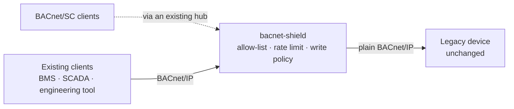

<h1><a href="https://saschakattelmann.de"></a>&#8202; BACnet Shield</h1>

[](https://pkg.go.dev/github.com/GalaxyGorilla/bacnet-shield)


A **BACnet/IP security proxy** for legacy building devices. One static binary.
The devices keep speaking plain BACnet/IP; the proxy does all the shielding
work between them and the building's clients. One process can protect several
devices as independent listener↔device pairs — co-hosting, not routing.

**Status:** production-ready for the documented v1 software scope. The protocol
codecs are fuzzed, the data plane is race-tested, and independent stacks drive
the built binary on both legs: bacpypes3 for BACnet/IP, and bacnet-stack's own
`sc-hub` plus BSC clients for BACnet/SC. Physical-device commissioning is still
required; see [Production readiness](#production-readiness).

**Never heard of BACnet?** Read the [two-minute primer](examples/gateway.md#0-two-minutes-of-bacnet-background)
below the fold — everything else in this document assumes only that.



**Choose your starting point:**

- One legacy device, point your clients at the box →
  [gateway walkthrough](examples/gateway.md).
- Decide who may connect, how hard they may poll, and which writes pass →
  [access control](examples/access-control.md).
- Secure clients (BACnet/SC) in front of the same device →
  [SC front leg](examples/sc.md).
- The box is running — install, commission, monitor, reload, troubleshoot →
  [operations](examples/operations.md).

If you are unsure, start with the [gateway walkthrough](examples/gateway.md).

## Why

BACnet/IP is a clear, unauthenticated protocol designed for building
automation. A controller that has been in a wall for fifteen years cannot be
given authentication, an ACL or a write policy. Replacing it is an expensive
commissioning project, and its firmware is not yours to change.

bacnet-shield is the boundary instead:

- **Zero-touch on the device** — no firmware change, no object or property
  remapping. Vendor quirks inside service payloads pass through untouched.
- **Client allow-list** — only the BMS/SCADA segment reaches the device; an
  off-list peer is dropped silently.
- **Per-client rate limit** — one runaway poller cannot spend the device's
  capacity for everyone else; an optional shared budget caps the total rate
  toward the device even when many clients poll at once.
- **Write protection** — either all-or-nothing read-only, or rules scoped to
  `<object-type>:<instance>:<property>` with `*` wildcards.
- **Honest refusals** — a denied write is answered with a BACnet Error PDU
  (class `security`, code `write-access-denied`), so the client fails
  immediately instead of timing out.
- **COV routing** — a client's SubscribeCOV, SubscribeCOVProperty or
  SubscribeCOVPropertyMultiple is remembered, and the device's
  notifications are delivered back to that client, never broadcast.
- **Secure front leg** — BACnet/SC clients attach through an existing hub over
  TLS 1.3 + WebSocket and get the same allow-list, rate limit, write policy and
  COV routing as the IP clients, each keyed by its own VMAC.
- **Change without downtime** — `SIGHUP` swaps the front-leg policy in place;
  clients and the device socket stay up.
- **Audit trail** — opt-in: every ACL, rate, budget and write decision is
  appended as one JSON object per line, with the object/property a refused
  write targeted, so an incident can be reconstructed without guessing from
  counters.

The v1 essence: a **strict forwarder** — the service payload goes in and out
byte for byte; only the link/network headers and the APDU invoke ID are
rewritten, and only the front-leg policy can reject a request.

## Is bacnet-shield the right tool?

Not always. Prefer the simplest boundary that solves the problem:

- **The device already speaks BACnet/SC** — enable it on the device and let it
  join the hub directly; a proxy adds no security benefit to a device that can
  already authenticate and encrypt its own traffic.
- **Only the network path needs protection, and clients are trusted** — a
  firewall rule or a site-to-site VPN (WireGuard/IPsec) segmenting the building
  network may be simpler.
- **You need a BACnet router, a BBMD, or a protocol translator** — bacnet-shield
  is a transport-level security gate for **one** device; it does not route
  between networks or remap the object model. Use a building-controller gateway
  for that. A client that can only reach the proxy through a BBMD
  (`Forwarded-NPDU`) is rejected by design; see
  [docs/b3-bbmd.md](docs/b3-bbmd.md) for the trust reason and the deployment
  shapes that avoid it.

Use bacnet-shield when the legacy device cannot change and you need an
appliance-like security gate in front of it: an allow-list, a per-client rate
limit, an object/property-scoped write policy, optional BACnet/SC, Prometheus
metrics, config validation and self-tests, a static binary and a hardened
systemd unit. It is intentionally opinionated about deployment and operations.

## Production readiness

The documented v1 scope is implemented and tested as software. The race suite
drives the built proxy on real loopback sockets; ten native fuzz targets —
the BVLC/NPDU/APDU/tag/object-ID codecs, the BVLL-SC body decoders and the
WebSocket frame parser — run in every `go test`; and two independent BACnet
stacks drive the built binary through the proxy — bacpypes3 (a Python stack) on
the IP leg and bacnet-stack 1.6.1's own `sc-hub` and BSC clients on the secure
leg. Reads,
writes, refusals, discovery, COV, segmented responses, reload and hub failover
are covered in addition to the race suite. The repository also supplies a
hardened service unit, health metrics, configuration validation, self-tests and
operational diagnostics.

**Known validation boundary:** the project has not yet been commissioned against
physical BACnet devices. Before relying on a specific installation, test it with
the real controller and the real vendor client: frame timing, retransmission
behaviour, COV lifetimes, segmented responses, device source-port changes and
network interruption. This is deployment validation, not unfinished
functionality in the documented scope. External security review and formal
BACnet conformance testing remain separate work; [`TESTING.md`](TESTING.md)
records the exact test coverage and [`CONFORMANCE.md`](CONFORMANCE.md) records
what the independent stacks found.

The commercial value is the retrofit boundary: operators can add identity,
scoped writes, rate limits and a standard secure transport without replacing the
installed asset or matching its object model. That also makes bacnet-shield
suitable as the BACnet module in a broader multi-protocol critical-infrastructure
appliance; appliance-level orchestration remains outside this repository.

## Deployment shape

**Not sure which shape is yours?** The one-line picker:

- "I just want a proxy in front of the device" → [Gateway](examples/gateway.md)
- "I need to decide who may connect and write" → [Access control](examples/access-control.md)
- "My clients speak BACnet/SC (or a hub already exists)" → [SC front leg](examples/sc.md)
- "Plant SCADA should monitor the proxy itself" → [Operations](examples/operations.md#monitor)

| Start here | Your situation | What changes |
|---|---|---|
| [Gateway](examples/gateway.md) | One legacy BACnet/IP device, one or more clients | Clients point at bacnet-shield; the device stays unchanged |
| [Access control](examples/access-control.md) | Different clients deserve different rights | Add an allow-list, a rate limit, and a scoped write policy |
| [SC front leg](examples/sc.md) | Clients or a head-end speak BACnet/SC | The proxy joins an existing hub as a node; the device stays plain IP |
| [Operations](examples/operations.md) | The box is deployed | Install as a service, commission, monitor, reload, troubleshoot |

**Several devices, one process.** A `devices:` list co-hosts several
listener↔device pairs in one binary, one config file and one metrics endpoint.
Each entry has its own front-leg policy and optional SC node; a client reaches
a device only through that device's listener. This is not a router: there is no
BBMD, no foreign-device registration and no traffic between devices. Give each
device its own local IP on the standard port 47808, so a client's broadcast
Who-Is still reaches the whole building:

```yaml
devices:
  - name: boiler
    listen_addr: 10.0.0.10:47808
    device_addr: 10.0.0.42:47808
    access: { read_only: true }
  - name: ahu
    listen_addr: 10.0.0.11:47808
    device_addr: 10.0.0.43:47808
    access:
      write_policy:
        default: deny
        rules: [{ oid: "analog-value:*:present-value", action: allow }]
```

Planned work and explicit non-goals are recorded in [BACKLOG.md](BACKLOG.md):
a BBMD/router role, an IPv6 device leg and physical commissioning remain out
of the current scope; UUID-keyed SC admission is not enforceable through a hub
and is documented there.

### IPv6 front leg

The client-facing listener may speak BACnet/IPv6 (Annex U): use an IPv6
literal for `listen_addr`, for example `"[::1]:47808"` or `"[::]:47808"`. The
proxy then accepts the IPv6 link-layer type (`0x82`), answers virtual-address
resolution, and keeps the same allow-list, rate limit, write policy, COV
routing and metrics. The **device leg stays plain IPv4** in this release, so the
usual retrofit shape is an IPv6 client network in front of an old IPv4
controller.

```yaml
devices:
  - name: boiler
    listen_addr: "[::]:47808"      # IPv6 clients
    device_addr: "10.0.0.42:47808" # legacy IPv4 device
    access:
      allow: ["2001:db8:10::/48"]  # IPv6 allow-list / rate limits apply
      read_only: true
```

A client discovers the proxy's 3-octet virtual address with
`VirtualAddressResolution`; the proxy derives a stable address from its bound
listener, so no extra configuration is needed. `device_addr` and
`device_local_addr` must stay IPv4 and are rejected during validation if they
are not.

## Scope

This is a **co-hosting gateway**: one or more independent listener↔device
pairs in one process, not a BACnet device stack and not a router.

| Supported | Deliberately not supported (v1) |
|---|---|
| One or more co-hosted legacy BACnet/IP devices per instance | BBMD, foreign-device registration, routing between networks |
| BACnet/IP clients, unicast and broadcast | A BACnet/SC **hub**: the proxy is a node, not a hub |
| BACnet/SC clients through an existing hub | SC direct (node-to-node) connections |
| Confirmed and unconfirmed services, payload opaque | Service translation or object/property remapping |
| SubscribeCOV, SubscribeCOVProperty and SubscribeCOVPropertyMultiple | Segmented subscriptions (denied fail-closed) |
| Segmented requests and responses, including authorized segmented writes | Segmented writes larger than the 16 KiB reassembly bound |
| IPv6 BACnet/IP clients on the front leg | BACnet/IPv6 on the device leg (still IPv4) |

A client broadcast is forwarded to **that listener's device** as unicast: a
device's listener has exactly one device, so a broadcast is a discovery request
aimed at it.

## Security controls

Every deployment has a client leg with peers you may or may not trust, so the
same `access` section governs all of it: **who** may connect, **how fast**, and
**what may be written**. The rules are identical for an IP client (keyed by
`ip:port`) and a BACnet/SC client (keyed by `vmac`), which is what lets both
front legs share one policy. See [access-control.md](examples/access-control.md)
for the full walkthrough.

```yaml
access:
  allow: ["10.8.0.0/24", "192.168.1.7"]   # client allow-list (IP or CIDR)
  sc_allow: ["02:00:00:00:00:0a"]         # SC allow-list (VMAC)
  rate_per_sec: 50                        # per-client request rate (0 = off)
  device_rate_per_sec: 200                # shared rate toward the device (0 = off)
  read_only: true                         # refuse every write
  # ...or, instead of read_only, a scope-limited write policy:
  # write_policy:
  #   default: deny
  #   rules:
  #     - {oid: "analog-value:5:present-value", action: allow}
  #     - {oid: "analog-value:*:present-value", action: deny}
```

`read_only` and `write_policy` are mutually exclusive; both at once is a config
error. `allow`, `sc_allow`, `rate_per_sec` and `device_rate_per_sec` are
independent and optional. The `rate_per_sec` bucket is keyed per client and is
the fairness control; `device_rate_per_sec` is a single shared bucket that bounds
the **total** rate toward the one device, so a fragile device is protected even
when many well-behaved clients poll at once. A request already refused by its own
per-client limit never charges the shared budget. Write protection is
**opt-in** — with neither configured, writes pass through unchanged — so turn it
on deliberately.

The write-policy evaluation rules are intentionally the same as the other Shield
proxies:

- **Deny overrides.** One matching deny rejects the whole request, so a
  WritePropertyMultiple can never straddle a forbidden object.
- **Allow must cover.** An allow authorizes a request only if it matches every
  object/property the request touches.
- **Uncovered requests take the default.** `default: deny` is an allow-list;
  `default: allow` is a deny-list.
- **Fail closed on the undecodable.** A write whose target cannot be decoded is
  denied, never forwarded "because we could not tell".
- **Segmented writes are reassembled first.** The proxy acknowledges the
  client's segments itself, authorizes the complete request, and only then
  forwards it as one unsegmented write. A forbidden target in a later segment
  is therefore still seen, and a denied segmented write gets the same Error PDU
  as a denied single-datagram write. A reassembly larger than 16 KiB, or one
  that arrives out of order, is refused rather than guessed at.
- **Service-level writes need the default.** CreateObject, DeleteObject,
  ReinitializeDevice, DeviceCommunicationControl, file writes, list edits and
  the other state-changing services have no object target to match, so only
  `default: allow` authorizes them.

Rule vocabulary is `<object-type>:<instance>:<property>`, with `*` in any part.
`analog-value:5` means every property of that object; `*` means every write. An
object type or property may be a name (`analog-value`, `present-value`) or its
ASHRAE 135 number. The same rules are available as flags: `--write-default`,
`--write-allow` and `--write-deny`.

Denials are explicit per policy class:

| Situation | Wire result |
|---|---|
| Off-list client, over the rate limit, or over the shared device budget | Silent drop (never advertise the proxy) |
| Write refused by policy | Error PDU, class `security` (4), code `write-access-denied` (40) |
| Unsupported subscription service | Error PDU, class `services` (5), code `service-request-denied` (29) |
| Confirmed COV notification with no subscriber | Error PDU, class `services` (5), code `unknown-subscription` (79) |
| Malformed frame, unsupported BVLC function, network message | Dropped and counted; never guessed at |

The error parameters are **application-tagged ENUMERATEDs**, the form a strict
BACnet stack expects; a raw-octet payload would be dropped by the peer and turn
a clean refusal into a timeout.

**Reload:** `SIGHUP` re-reads the config file and applies **each device's access
policy only** — `access.allow`, `access.sc_allow`, `access.rate_per_sec`,
`access.device_rate_per_sec`, `access.read_only`, `access.write_policy`, matched
by device `name`. The swap takes effect on the next datagram with no listener
rebind. Everything socket-, file- or crypto-bound (`listen_addr`, `device_addr`,
`device_local_addr`, `device_instance`, `request_timeout_secs`, `max_pending`,
`log_level`, `metrics.addr`, `audit.*` and the whole `sc` block), and adding or
removing a device, is reported as a restart-only warning rather than silently
ignored. An invalid file, or a policy that does not compile, keeps the running
policy.

### Audit trail

Denials are counted and logged, but an incident review needs to answer *"which
client tried to write what, and when was it refused"*. With `audit.file` set,
every security decision the front leg makes is appended as one JSON object per
line:

```json
{"time":"2026-11-02T09:14:03.512Z","event":"write_denied","leg":"ip","client":"10.8.0.5:51823","service":"write-property","targets":["analog-value,5:present-value"],"reason":"read_only"}
{"time":"2026-11-02T09:14:04.001Z","event":"acl_denied","leg":"sc","client":"sc:02:00:00:00:00:0a"}
```

- **Events:** `acl_denied`, `rate_limited`, `device_budget_denied`,
  `write_denied`, `unsupported_subscription`; `write_denied` carries the decoded
  `targets` and a stable `reason` (`read_only`, `segmented_write`,
  `undecodable_write`, `service_level_denied`, `deny_rule`, `default_deny`).
- **Bounded by construction.** The file rotates at `audit.max_mb` keeping one
  backup (about 2× the cap on disk); the producer is a bounded queue, so a
  denial flood drops records and counts them
  (`bacnet_shield_audit_dropped_total`) rather than stalling the data plane or
  filling the disk.
- **Off by default** — like every other Shield control, the audit is opt-in.
  See [examples/operations.md](examples/operations.md#audit-trail) and the
  annotated [`configs/gateway.yaml`](configs/gateway.yaml).

## BACnet/SC

The proxy attaches to an **existing** hub as one node, so the hub keeps doing
its job: authenticating connections and routing between nodes. The clear device
leg stays plain BACnet/IP, exactly as in the IP-only deployment. The secure leg
is additive — the IP listener stays up.

```yaml
sc:
  vmac: "02:00:00:00:00:01"
  uuid: "00112233-4455-6677-8899-aabbccddeeff"
  hubs:                       # primary first, failover after
    - "wss://hub1.example:47808/"
    - "wss://hub2.example:47808/"
  ca_file: "/etc/bacnet-shield/hub-ca.pem"   # optional; default is system roots
  # cert_file: "/etc/bacnet-shield/node.pem" # optional client certificate
  # key_file:  "/etc/bacnet-shield/node.key"

access:
  sc_allow:                   # optional; empty = accept whatever the hub sends
    - "02:00:00:00:00:0a"
    - "02:00:00:00:00:0b"
```

Every SC sender is identified by its **VMAC**, so SC clients are independent:
two nodes may use the same invoke ID, and each has its own rate bucket, replay
cache, pending requests and COV subscriptions. `sc_allow` is a second gate
behind hub authentication; with no list configured, admission is opt-in like
every other Shield control.

The proxy rejects a node's frame addressed to another VMAC and a frame without
an originating VMAC, even though the hub should already have routed it
correctly, and it never asserts its own originating VMAC on the way out. The
hub attributes a frame only to a VMAC, so the allow-list is keyed by VMAC; a
UUID rule cannot be enforced for hub-delivered traffic and is rejected rather
than pretended to work.

Flags mode has the same surface: `--sc-vmac`, `--sc-uuid`, `--sc-hub`,
`--sc-ca`, `--sc-cert`, `--sc-key` and `--sc-allow`.

A hub outage does not stop the IP leg: the node logs the failure and reconnects
with backoff across the configured hub list. Systemd readiness means the IP
listener is bound; the SC link state is on the metrics endpoint
(`bacnet_shield_sc_connected`) and in the log, not used as a readiness gate. See
[sc.md](examples/sc.md).

## How it works

The proxy is a strict forwarder with three pieces of state. Both front legs feed
the same state: a client is a client whether its identity is `ip:port` or a
6-octet SC VMAC, which is what keeps two SC nodes from sharing an invoke-ID
space.

1. **Invoke-ID translation.** Every client has its own one-octet invoke-ID
   space, so two clients may both have request 7 in flight. The proxy allocates
   a device-leg ID per client request (up to `max_pending`, default 256),
   rewrites the octet on the way out, and patches it back on the answer. Two
   answers for the same client/invoke pair cannot be swapped.
2. **Retransmission handling.** A retransmission of a request still in flight
   is **dropped**, not forwarded: re-sending a write would apply it twice.
   After a response completes, a short-lived cache (30 s) replays that exact
   answer to a client retransmission. A client that reuses an invoke ID for a
   *different* request is treated as a new exchange.
3. **COV subscriber tracking.** A SubscribeCOV, SubscribeCOVProperty or
   SubscribeCOVPropertyMultiple is installed only after the device answers with
   a SimpleACK. A multi-object subscription is installed object by object, so a
   later notification about any one of them still routes; a single
   notification-multiple is delivered once to each subscriber even when it names
   several objects that client watches. A rejected subscription is never
   routed. Notifications are mapped back by monitored object and
   subscriber-process identifier. A confirmed notification with no subscriber
   is answered with an Error PDU so the device stops retransmitting.

Segmented responses and device-initiated segmented requests are tracked per
invoke ID and relayed; the proxy does not reassemble their payloads. A
segmented *write* is the exception: the proxy acts as the server for the
client's segment transfer, acknowledges each non-final segment, reassembles the
APDU, authorizes every target, and forwards one unsegmented request. Every
state table is bounded and swept once per second, and a soak test asserts flat
goroutines/heap with zero unanswered requests.

## Quick start

Build (plain Go toolchain, no other build dependency):

```bash
make            # or: go build -o bin/bacnet-shield ./cmd/bacnet-shield
```

### Plug and play (no config file)

```bash
# everybody may read; nobody may write; only the BMS segment may connect
bacnet-shield gateway \
  --listen :47808 \
  --device 10.0.0.42:47808 \
  --read-only \
  --allow 10.8.0.0/24 \
  --rate-per-sec 50
```

Point the clients at the proxy address instead of the device. If the proxy and
the device share a host, give the proxy a different client port (for example
`:47809`). Full walkthrough: [examples/gateway.md](examples/gateway.md).

### Scoped writes instead of all-or-nothing

```bash
# reads open; only analog-value 5's setpoint may be written, for anyone
bacnet-shield gateway \
  --listen :47808 --device 10.0.0.42:47808 --allow 10.8.0.0/24 \
  --write-default deny \
  --write-allow 'analog-value:5:present-value'
# 'analog-value:*:present-value' matches every instance of the type; a deny
# rule wins over an allow, and an allow must cover the whole write target.
```

### Config files

One file describes one process: the observability settings plus a `devices:`
list of one or more listener↔device pairs. Start from
[`configs/gateway.yaml`](configs/gateway.yaml):

```yaml
devices:
  - name: boiler
    listen_addr: ":47808"
    device_addr: "10.0.0.42:47808"
    device_instance: 1001
    access:
      allow: ["10.8.0.0/24"]
      read_only: true
```

```bash
bacnet-shield gateway --config /etc/bacnet-shield/gateway.yaml

# apply edited ACLs, rate limit and write policy without dropping clients:
kill -HUP "$(cat /run/bacnet-shield.pid)"   # or: systemctl reload bacnet-shield-gateway
```

Flags mode always configures exactly one device; several co-hosted devices need
a file.

## Tools

```bash
# check a config without running (pre-apply hook for tooling/web UIs):
bacnet-shield validate --config gateway.yaml
bacnet-shield validate --config gateway.yaml --json   # machine-readable

# validate + probe the device with a real request; --probe=false skips the network:
bacnet-shield selftest --config gateway.yaml
bacnet-shield selftest --config gateway.yaml --probe=false

bacnet-shield version
```

`selftest` sends one real request from this host to the device leg. With a
pinned `device_instance` it reads `device,<instance>,object-name`; without one
it sends a Who-Is and reports the first I-Am from the configured address. A
BACnet Error PDU counts as reachability (the device answered) and is reported
with its class and code. Both `validate` and `selftest` accept the same flags as
`gateway` (or `--config`), so a web UI can build the form, validate with
`validate --json`, and offer a "test connection" button backed by
`selftest --json`.

## Metrics

Set `metrics.addr` (or `--metrics-addr`) to expose a Prometheus scrape at
`/metrics`. An empty address disables the listener; bind it to loopback unless
the monitoring network is trusted. Every per-device counter and gauge carries a
`device` label (the config entry's `name`, or its `device_addr`), so one scrape
covers every co-hosted device; the audit-drop counter is process-wide and has
no device label.

| Metric | Meaning |
|---|---|
| `bacnet_shield_requests_total` | Client-leg NPDUs received (IP or SC) |
| `bacnet_shield_forwarded_total` | Requests forwarded to the device leg |
| `bacnet_shield_responses_total` | Device answers relayed to a client |
| `bacnet_shield_acl_denied_total` | Requests dropped by the IP or SC allow-list |
| `bacnet_shield_rate_limited_total` | Requests dropped by the per-client rate limit |
| `bacnet_shield_device_rate_limited_total` | Requests dropped by the shared per-device rate budget |
| `bacnet_shield_writes_denied_total` | Writes refused by the write policy |
| `bacnet_shield_parse_errors_total` | Undecodable datagrams dropped |
| `bacnet_shield_pending_full_total` | Requests dropped because every invoke ID was in flight |
| `bacnet_shield_unsupported_total` | Frames or services the proxy cannot serve |
| `bacnet_shield_replayed_total` | Retransmissions answered from the finished-response cache |
| `bacnet_shield_retransmits_dropped_total` | Retransmissions dropped while the request is in flight |
| `bacnet_shield_notifications_dropped_total` | Device notifications with no client to receive them |
| `bacnet_shield_segmented_writes_total` | Segmented writes reassembled for authorization |
| `bacnet_shield_segmented_writes_rejected_total` | Segmented writes refused because reassembly was unbounded or out of order |
| `bacnet_shield_request_timeouts_total` | Forwarded requests that expired without a complete answer |
| `bacnet_shield_audit_dropped_total` | Audit records dropped because the audit queue was full |
| `bacnet_shield_pending` | Requests currently in flight toward the device |
| `bacnet_shield_cov_subscriptions` | Active COV subscriptions routed by the proxy |
| `bacnet_shield_sc_connected` | 1 while the BACnet/SC leg is attached to a hub, 0 otherwise |
| `bacnet_shield_sc_reconnects_total` | Successful re-attaches to a hub after the first connection |
| `bacnet_shield_forward_latency_seconds` | Histogram from forwarding a confirmed request to the response that answers it |

## Appliance deployment

- **Static binary** — `make release` builds a stripped, CGO-free binary for
  Linux; `make release-all` cross-builds linux-amd64, linux-arm64 and
  linux-armv7 into `dist/`.
- **systemd** — [`deploy/bacnet-shield-gateway.service`](deploy/bacnet-shield-gateway.service)
  is a hardened `Type=notify` unit with a 30 s watchdog, `Restart=on-failure`
  and a restricted address-family list (`AF_UNIX` is included for sd_notify).
  The binary sends `READY=1` only after both sockets bind and pings
  `WATCHDOG=1` while running, so a bind failure is never advertised as ready and
  a wedged process is restarted by the host.
- **Graceful restart** — on `SIGTERM` the front leg stops accepting and waits
  up to two seconds for requests already at the device to be answered, so a
  restart does not turn an in-flight write into a client timeout. The device
  leg stays open for that drain; the BACnet/SC transport outlives it by the
  same window so the answer can still travel through the hub.
- **Supply chain** — `make sbom` produces SPDX + CycloneDX documents for the
  release binary (`syft`); `make vulnscan` scans them with `grype` and fails on
  HIGH or worse. Both exit 77 when the tool is missing.
- **No CI by design.** The gates are `make` targets run locally; see
  [TESTING.md](TESTING.md) and [examples/operations.md](examples/operations.md).

## Testing

```bash
make test        # gofmt gate + full race suite
make verify      # build + race suite + vet
make acceptance  # verify + independent bacpypes3 peer
make soak        # long-running leak and spoofed-source floods (opt-in)
make security    # verify + staticcheck + govulncheck + SBOM scan
make interop     # built binary against bacpypes3 on both legs
make interop-sc  # built binary over BACnet/SC against bacnet-stack's hub
```

The interop suites need their peers provisioned once:

```bash
make peers         # creates .venv and installs bacpypes3 0.0.110
make sc-hub-image  # builds bacnet-stack 1.6.1's sc-hub in Docker
```

Each exits 77 when its peer is missing, so a bare machine stays green; a
release run treats that as a failure. The suite is deliberately adversarial —
malformed and truncated frames, spoofed sources, invoke-ID collisions,
retransmissions, write-policy straddles, segmented bypasses and unknown
subscriptions, not only happy paths. See [TESTING.md](TESTING.md) for the layers
and [CONFORMANCE.md](CONFORMANCE.md) for what the independent stacks found.

The SC leg is covered by the same races: the BVLL-SC codec is golden-byte
cross-checked against bacpypes3, the WebSocket parser is fuzzed, and the node is
driven against a real in-process TLS hub (connect, heartbeat, reconnect,
destination filtering). Proxy tests then drive two SC nodes with the same invoke
ID through the shared data plane. `make interop-sc` runs the proxy as a node of
bacnet-stack's own `sc-hub` and drives it with bacnet-stack's BSC clients, so
the SC transport is also proven against a third-party implementation.

## Documentation

- [`examples/`](examples/) — copy-paste walkthroughs with a scenario picker:
  [gateway](examples/gateway.md) (start here; includes a two-minute BACnet
  primer), access control, the SC front leg, and the operations guide.
- [`configs/gateway.yaml`](configs/gateway.yaml) — annotated configuration.
- [`deploy/`](deploy/) — hardened systemd unit.
- [`SECURITY.md`](SECURITY.md) — protected assets, trust boundaries, enforced
  controls and deliberate limits.
- [`TESTING.md`](TESTING.md) — test layers and release/security gates.
- [`CONFORMANCE.md`](CONFORMANCE.md) — independent-peer results, divergences
  and deliberate limits.
- [`docs/b3-bbmd.md`](docs/b3-bbmd.md) — why BBMD/forwarded-NPDU clients are
  rejected and what a future trusted-BBMD mode would have to guarantee.
- [`BACKLOG.md`](BACKLOG.md) — what is planned and what is explicitly out of
  scope.
- [`AGENTS.md`](AGENTS.md) — architecture, wire-level invariants and the
  maintenance rules.

## License

[MIT](LICENSE)
