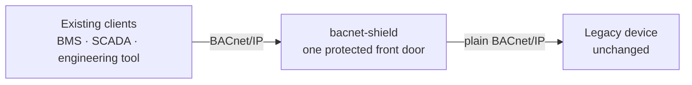

# Gateway box (one box in front of the legacy device)

A single bacnet-shield box in front of one legacy BACnet/IP device — the primary
retrofit deployment. Every client, on the clear IP leg or the secure BACnet/SC
leg, is gated by the same allow-list, rate limit and write policy before
anything reaches the device. The device-side wire stays 100% plain BACnet/IP.

**This is your walkthrough if:** you have one legacy device that speaks
BACnet/IP (a controller, VAV box, chiller, rooftop unit, meter, ...), you cannot
or do not want to modify it, and you want it protected. Start at section 0 for
the BACnet background, then paste two lines.



This is the deployment for the retrofit use case: the box **is** the device's
security gate — blocked writes and rejected clients never reach the legacy
device, and the device notices nothing.

## 0. Two minutes of BACnet background

Everything else on this page assumes only this:

- **What BACnet is.** The network language of building automation: heating,
  cooling, ventilation, lighting, access, energy meters. A client asks, the
  device answers — "what is the present value of analog input 3?" → "21.5".
  The same protocol also *commands* the device: BACnet can write a setpoint,
  start a fan, or override a schedule.
- **Objects and properties.** Everything in a BACnet device is an **object**
  of a type (`analog-value`, `binary-output`, `schedule`, ...) with an instance
  number, and each object has **properties** (`present-value`, `object-name`,
  `setpoint-reference`, ...). The pair `object:instance` and a property name is
  how bacnet-shield scopes a write rule, e.g.
  `analog-value:5:present-value`.
- **Why it matters here.** Classic BACnet/IP has **no authentication and no
  encryption** — it was designed for a trusted building LAN, long before the
  IT/OT network was shared with anything. Anyone who can reach the device on
  UDP port 47808 can read it *and write it*.
- **Why old devices cannot just be fixed.** A controller that has been in a wall
  for fifteen years has no budget for a firmware upgrade, no way to add an ACL,
  and no TLS. Replacing it means a commissioning project.
- **What the box changes.** Nothing about the device. It speaks BACnet/IP toward
  the device exactly as clients did before, and speaks BACnet/IP toward clients
  exactly as the device expected. Only now there is something in between that
  drops strangers, counts requests, and refuses forbidden writes with a real
  BACnet answer.

You do not need more BACnet knowledge to deploy the box. Where a walkthrough
needs device-specific values (object instance numbers, property names), they
come from your device's documentation, not from this project.

## 1. Run it (paste two lines)

No config file is needed for a single device:

```bash
bacnet-shield gateway \
  --listen :47808 \
  --device 10.0.0.42:47808 \
  --read-only \
  --allow 10.8.0.0/24 \
  --rate-per-sec 50
```

- `--listen` — the client leg (clients repoint here once). `47808` is the
  standard BACnet/IP UDP port. If the proxy and the device share a host, use a
  different client port here (for example `:47809`).
- `--device` — the one legacy device (plain BACnet/IP, unmodified). It must be
  a unicast IPv4 address.
- `--read-only` — every write is refused with a BACnet Error PDU
  (class `security`, code `write-access-denied`) that comes from the proxy; the
  device never sees the write.
- `--allow` — client allow-list (IP or CIDR, repeatable). Omit it to allow any
  client.
- `--rate-per-sec` — per-client request rate limit, so one runaway poller cannot
  spend the device's capacity for everyone else.

Point every client at the box IP instead of the device IP — that repointing is
the whole migration.

## 2. Or with a config file

For anything more than a two-line install, use YAML — one file describes one
process and a `devices:` list. Start from
[`configs/gateway.yaml`](../configs/gateway.yaml):

```bash
bacnet-shield gateway --config /etc/bacnet-shield/gateway.yaml
```

The example config is fully annotated and covers each device's client leg,
device address, optional device instance, timeouts, access policy and optional
BACnet/SC block, plus the process-wide metrics and audit settings. Add more
entries under `devices:` to protect several devices with one process; each needs
its own local IP on port 47808 and carries its own policy.

## 3. Verify on site

```bash
# pre-apply check: config syntax, addresses, allow-lists, policy compile
bacnet-shield validate --config /etc/bacnet-shield/gateway.yaml

# environment check: a real BACnet request from this host to the device leg
# (a BACnet Error PDU still counts as reachable — the device answered)
bacnet-shield selftest --config /etc/bacnet-shield/gateway.yaml
```

`selftest` sends one real request. With a pinned `device_instance` it reads
`device,<instance>,object-name`; without one it sends a Who-Is and reports the
first I-Am from the configured address. Add `--probe=false` to validate the
configuration only, and `--json` for machine-readable output (a web UI can
build the form, validate with `validate --json`, and offer a "test connection"
button backed by `selftest --json`).

## 4. Wire a real client

Any BACnet client works unchanged — only the target address changes. Point the
client's device address at the box. A minimal example with
[bacpypes3](https://github.com/JoelBender/bacpypes3), the Python BACnet stack
this project cross-checks against:

```bash
pip install bacpypes3
python - <<'PY'
import asyncio
from bacpypes3.app import Application
from bacpypes3.argparse import SimpleArgumentParser
from bacpypes3.apdu import ReadPropertyRequest
from bacpypes3.basetypes import PropertyIdentifier
from bacpypes3.pdu import Address
from bacpypes3.primitivedata import ObjectIdentifier

async def main():
    app = Application.from_args(SimpleArgumentParser().parse_args())
    resp = await app.request(ReadPropertyRequest(
        objectIdentifier=ObjectIdentifier("analog-value,1"),
        propertyIdentifier=PropertyIdentifier("present-value"),
        destination=Address("10.8.0.9:47808"),   # the BOX, not the device
    ))
    print(resp)

asyncio.run(main())
PY
```

A successful read prints the property value. A refused write prints the tagged
Error PDU instead of hanging. The device keeps its object model; vendor quirks
inside service payloads flow through untouched (the proxy parses only enough to
route and gate).

## Protection semantics

- Writes on a `read_only` gateway: **refused** with a proxy-generated BACnet
  Error PDU (class `security` = 4, code `write-access-denied` = 40) — that
  refusal is the protection; the device never sees the write.
- Writes outside a `write_policy` rule: **refused** the same way. Deny rules win
  over allow rules, an allow rule must cover the WHOLE write target (a
  WritePropertyMultiple cannot straddle an allowed rule), and a write whose
  target cannot be decoded is denied. A segmented write is reassembled first,
  so every target is visible; an over-limit or out-of-order transfer is
  refused rather than guessed at.
- Clients outside `allow`: **silent drop**. An off-list peer must not learn a
  proxy is there, and an error answer would only amplify a flood.
- Bursts above `rate_per_sec`: **silent drop**, for the same reason.
- A malformed frame or an unsupported BVLC function: **dropped and counted**,
  never guessed at.

## Hardening options

- **Object-scoped writes instead of read-only** — `read_only` is
  all-or-nothing; `write_policy` decides *which* writes pass:

  ```yaml
  access:
    write_policy:
      default: deny                     # allow-list mode
      rules:
        - oid: "analog-value:5:present-value"
          action: allow                 # one writable setpoint
        - oid: "analog-value:*:present-value"
          action: deny                  # deny wins over allow
        - oid: "*:*:object-name"
          action: allow                 # every object may be named
  ```

  Rule vocabulary is `<object-type>:<instance>:<property>`, with `*` allowed in
  any part. An object type or property may be a name (`analog-value`,
  `present-value`) or its ASHRAE 135 number. Flags equivalent:

  ```bash
  --write-default deny \
  --write-allow 'analog-value:5:present-value' \
  --write-deny  'analog-value:*:present-value'
  ```

  `read_only` and `write_policy` are mutually exclusive; both at once is a
  config error.
- **Protect the device's polling capacity** — `rate_per_sec` caps each client;
  `device_rate_per_sec` caps the total across all clients, so a device whose
  real limit is aggregate traffic is protected even when several well-behaved
  pollers add up. `max_pending` (default 256) caps how many requests may be in
  flight at once.
- **Pin the device-leg source** — `device_local_addr` fixes the source address
  the proxy uses toward the device, which a firewall rule or a BBMD/foreign-
  device table can then key on.
- **BACnet/SC front leg** — expose the same device to BACnet/SC clients on the
  secure leg; see [sc.md](sc.md).
- **Prometheus metrics** — `metrics.addr` (or `--metrics-addr :9203`) serves
  allow-list, rate-limit, write-denial and replay counters plus the SC link
  gauges. Operations-side only; the device sees nothing.

## Shielding notes

- **One device per instance.** Multi-device, BBMD and routing are backlog; the
  proxy deliberately does not pretend to be a router. See
  [BACKLOG.md](../BACKLOG.md).
- **Opaque forwarding.** The proxy rewrites only the link/network headers and
  the APDU invoke ID; the service payload is forwarded byte for byte, so a
  vendor that diverges from the spec keeps working (and the divergence is
  recorded in [CONFORMANCE.md](../CONFORMANCE.md), never adapted away).
- **Retransmissions.** A retransmission of a request still in flight is
  **dropped** — re-sending a write would apply it twice. Once a response
  completes, a short-lived cache (30 s) replays that exact answer, so a client
  whose answer was lost recovers without the device being asked again.
- **COV.** A client's SubscribeCOV is installed only after the device answers
  with a SimpleACK, and the device's notifications are routed back to that
  subscriber — never broadcast to everyone.
