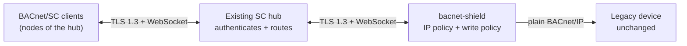

# BACnet/SC front leg (secure clients, one legacy device)

Add a **BACnet/SC** (Secure Connect) front leg to the same box that protects one
legacy BACnet/IP device. SC clients reach the proxy over TLS 1.3 + WebSocket
through an **existing hub**; the clear device leg stays plain BACnet/IP and the
device is untouched.

**This is your walkthrough if:** your clients or head-end already speak
BACnet/SC, or your site already runs an SC hub and you want the legacy device to
join it without giving the device any security capability of its own.



## 0. Two minutes of BACnet/SC background

- **BACnet/SC is the standard secure transport** (ASHRAE 135, BVLC-SC function
  `0x82`): TLS 1.3 for the connection plus a small WebSocket framing layer, with
  the ordinary BACnet network/application payload inside. It was added to the
  standard precisely because classic BACnet/IP is clear and unauthenticated.
- **It is hub-based.** SC nodes do not talk to each other directly; they attach
  to a **hub**, which authenticates connections and routes messages between
  nodes. Each node has a 6-octet **VMAC** (its address on the SC virtual link)
  and a 16-octet **UUID** (its device identity).
- **The proxy is a node, not a hub.** It attaches to the hub you already run. It
  does not provide a hub, and it does not make node-to-node connections.
- **The point is a standard boundary.** A private PSK tunnel would be easier to
  write but useless to everyone else; SC is a boundary other BACnet stacks can
  join. bacnet-shield's SC leg is interop-tested against bacnet-stack 1.6.1's
  own `sc-hub` and BSC clients.

## 1. What you need first

- An **existing SC hub** reachable over `wss://`. The proxy is a client of it.
- A **VMAC** for the proxy that is unique on the hub, e.g.
  `02:00:00:00:00:01`. The `02:` prefix marks it locally administered.
- A **UUID** for the proxy (any 16 octets in the canonical
  `8-4-4-4-12` hex form).
- If the hub presents a certificate your system trust store does not already
  trust: the **CA bundle** that signed it (`ca_file` / `--sc-ca`).
- If the hub requires client certificates: the proxy's **certificate and key**
  (`cert_file`/`key_file` or `--sc-cert`/`--sc-key`).

## 2. Configure the leg

Add an `sc:` block to the same file that describes the device. The clear leg and
the access policy are unchanged:

```yaml
devices:
  - name: boiler
    listen_addr: ":47808"          # the IP leg stays up too (additive, not a swap)
    device_addr: "10.0.0.42:47808"
    device_instance: 1001

    sc:
      vmac: "02:00:00:00:00:01"
      uuid: "00112233-4455-6677-8899-aabbccddeeff"
      hubs:                                          # primary first, failover after
        - "wss://hub1.example:47808/"
        - "wss://hub2.example:47808/"
      ca_file: "/etc/bacnet-shield/hub-ca.pem"       # optional; system roots if unset
      # cert_file: "/etc/bacnet-shield/node.pem"     # optional client certificate
      # key_file:  "/etc/bacnet-shield/node.key"

    access:
      sc_allow:                                      # optional VMAC allow-list
        - "02:00:00:00:00:0a"
        - "02:00:00:00:00:0b"
      write_policy:
        default: deny
        rules:
          - {oid: "analog-value:5:present-value", action: allow}
```

Each `devices:` entry with an `sc:` block is its own SC node, so a co-hosted
second device needs its own `vmac`/`uuid` and may attach to the same hub.

Flags mode has the same surface:

```bash
bacnet-shield gateway \
  --device 10.0.0.42:47808 --device-instance 1001 --read-only \
  --sc-vmac 02:00:00:00:00:01 \
  --sc-uuid 00112233-4455-6677-8899-aabbccddeeff \
  --sc-hub wss://hub1.example:47808/ \
  --sc-hub wss://hub2.example:47808/ \
  --sc-ca /etc/bacnet-shield/hub-ca.pem \
  --sc-allow 02:00:00:00:00:0a
```

A partially configured `sc` block — a VMAC without a UUID, a hub without TLS, a
`cert_file` without a `key_file` — is a validation error, never a silently
disabled leg. `bacnet-shield validate` catches it before you start.

## 3. Identity and policy on the secure leg

- **Every SC sender is identified by its VMAC**, never by the connection. Two SC
  nodes may use the same APDU invoke ID at the same time and each gets its own
  answer, because the pending table, the replay cache and the COV subscriptions
  are keyed by VMAC exactly as IP clients are keyed by `ip:port`.
- **`sc_allow` is a second gate behind the hub.** With no list configured, any
  node the hub delivers is accepted and only the write policy gates it — the same
  "protection is opt-in" shape as the IP leg. With a list, an off-list VMAC is
  silently dropped.
- **The rate limit is per VMAC**, so one noisy SC node cannot exhaust another's
  budget, and the SC and IP legs do not share buckets.
- **The write policy is identical** to the IP leg, including the tagged Error PDU
  for a refused write — a client cannot tell which leg it is on.

The node also defends itself even though the hub should have routed correctly:

- a frame addressed to a **different VMAC** is dropped;
- a frame with **no originating VMAC** (or a zero one) is dropped;
- on outbound messages the node sets **only** the destination VMAC — it never
  asserts its own originating VMAC, which the standard forbids and bacnet-stack's
  hub rejects.

## 4. Verify the leg

```bash
# config check, including the SC block and TLS files
bacnet-shield validate --config /etc/bacnet-shield/gateway.yaml

# watch the node attach
bacnet-shield gateway --config /etc/bacnet-shield/gateway.yaml
# log: "sc: attached to hub" with the hub URL
```

With `metrics.addr` set, the link state is on the scrape:

| Metric | Meaning |
|---|---|
| `bacnet_shield_sc_connected` | `1` while attached to a hub, `0` during an outage |
| `bacnet_shield_sc_reconnects_total` | Successful re-attaches after the first connection |

Then drive a real SC client through the hub. The proxy behaves as the one
device: a Who-Is is answered with the device's I-Am, a ReadProperty reaches the
device and comes back, and a refused write is answered with the tagged Error PDU
over SC.

## 5. Hub outages and failover

A hub outage does **not** stop the IP leg, and it does not stop the process. The
node logs the failure, walks the configured hub list (primary first, then
failover), and reconnects with exponential backoff (1–30 s). Systemd readiness
means the **IP listener** is bound; the SC connection is reported through the log
and the `sc_connected` gauge, not used as a readiness gate.

## 6. Generating a test PKI

The interop suite ships a small PKI generator (`scripts/sc-certs.sh`) that
produces a CA, a hub certificate with SAN `127.0.0.1`, and a client certificate.
It is a convenience for a lab, not a production PKI:

```bash
sh scripts/sc-certs.sh /tmp/sc-certs
```

The example certificates shipped with bacnet-stack carry only a CN and no SAN;
Go ignores a CN for hostname verification, so use certificates that carry a SAN
for the hub.

## Deliberate limits

- **No hub role.** The proxy is always a WebSocket *client* of a hub; it never
  accepts SC connections itself.
- **No SC direct (node-to-node) connections.** That needs the hub.
- **VMAC-only admission.** The SC data path carries the sender's VMAC but not its
  UUID; a UUID-keyed rule would need Address-Resolution and a bounded VMAC→UUID
  cache, which the node does not implement. `sc_allow` accepts VMAC entries only
  and rejects a UUID entry rather than pretending to enforce it. See
  [BACKLOG.md](../BACKLOG.md).
- **The IP leg is always present.** SC is additive; there is no SC-only mode.
